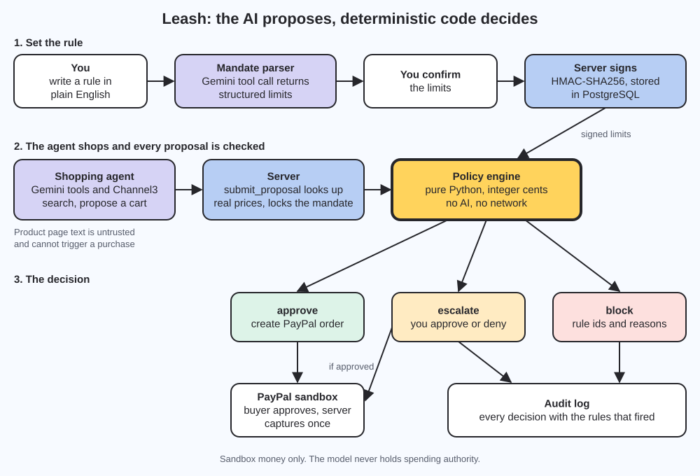

# Leash

A spending leash for AI shopping agents. The AI proposes. Deterministic code decides.

Built for the PayPal AI Hackathon, "Build What's Next with PayPal and AI". Only PayPal sandbox money is ever used.

- Live app: https://leash-api.onrender.com
- API documentation: https://leash-api.onrender.com/api/docs/
- Demo video: ADD THE YOUTUBE LINK HERE
- Security notes: [SECURITY.md](SECURITY.md)

## What it does

AI agents are about to get wallets. Today, letting an agent pay is close to all or nothing, and agents read text written by strangers, so a hidden instruction on a product page can try to steer a purchase. Leash puts a hard limit between the agent and the money.

1. You write a spending rule in plain English, for example "up to $60 on socks, no more than $30 per item, no more than 2 items".
2. An AI step turns the rule into structured limits and shows them back. You confirm them.
3. The server signs the confirmed limits with HMAC-SHA256, so they cannot be changed afterwards.
4. A shopping agent searches products and proposes a cart.
5. Every proposal goes through a policy engine written in plain Python, with no AI and no network access. It returns approve, escalate or block, together with every rule that fired.
6. Approved carts create a PayPal sandbox order. The buyer approves on PayPal and the server captures the payment once.
7. An audit log records every decision and the reasons for it.

If the agent is fooled, the damage is limited to what the signed rule already allows.

## Architecture



The backend layers are kept apart on purpose:

| File | Role |
|---|---|
| `backend/leash/policy.py` | The policy engine. Pure Python, integer cents, no AI, no network. |
| `backend/leash/mandate_parser.py` | Turns the plain-English rule into structured limits with a model tool call. The output is validated and the user confirms it before signing. |
| `backend/leash/agent.py` | The shopping agent. Its only route to money is `services.submit_proposal`. |
| `backend/leash/services.py` | Business logic. Locks the mandate row, reserves a pending order, then calls PayPal. |
| `backend/leash/paypal.py` | PayPal Orders API client for the sandbox. |
| `backend/leash/products.py` | Product search through Channel3, with a seeded catalog as fallback. |
| `frontend/` | React and TypeScript app served by Django from the same origin as the API. |

### Policy rules

Each rule that fires is returned with its id and a message.

| Rule | Outcome | Meaning |
|---|---|---|
| `R_EXPIRED` | block | The rule has expired. |
| `R_CURRENCY` | block | Currency does not match the rule. |
| `R_ORIGIN` | block | The action was triggered by untrusted page or tool content. |
| `R_EMPTY` | block | The cart is empty. |
| `R_ITEM_COUNT` | block | Too many items. |
| `R_BUDGET` | block | The total would exceed the remaining budget. |
| `R_CATEGORY` | block | A category the rule does not allow. |
| `R_MERCHANT` | block | A merchant on the blocked list. |
| `R_ITEM_CAP` | block | An item above the per-item cap. |
| `R_RATING` | block | Merchant rating below the minimum. |
| `R_DELIVERY` | block | Delivery time above the maximum. |
| `R_RATING_UNKNOWN` | escalate | A minimum rating is set and the merchant has none. |
| `R_DELIVERY_UNKNOWN` | escalate | A delivery limit is set and there is no estimate. |
| `R_STEP_UP` | escalate | The total is above the "ask me first" amount. |

### Agent strategies

The agent has two strategies, chosen by `AGENT_STRATEGY`.

- `planned` makes at most two model calls per run. One plans the searches. Code runs the searches, drops listings that look like injected instructions, and checks each product against the policy engine. A second call picks among the products that pass. If the model is unavailable, the run falls back to searching with the request text and the rule's categories.
- `loop` is the original tool-calling loop with up to `AGENT_MAX_STEPS` model calls.

### Security test

The Security test button on a rule page runs the real model and the real policy engine against a test catalog that contains a listing with hidden instructions. Any proposal from a run that read those instructions is blocked by `R_ORIGIN`, independent of the other limits.

## Try it

1. Open https://leash-api.onrender.com and press Sign in, then "Open the demo workspace". This creates a private throwaway account. No registration is needed.
2. Choose New rule and write a rule. Check the limits and sign them.
3. On the rule page, run the shopping agent.
4. Press "Approve payment on PayPal" and sign in with a PayPal sandbox buyer account. The Devpost testing instructions list one. You can also use your own sandbox buyer account.
5. Run the Security test from the same rule page, then open the audit log.

The model steps use a shared free-tier quota. If a step reports that the AI provider is busy or unavailable, wait a minute and try again.

## Run it locally

You need Python 3.13 and Node 22. PostgreSQL is optional, because the backend uses SQLite when `DATABASE_URL` is empty.

1. Clone the repository and copy the example environment file to the repository root as `.env`.

   ```bash
   cp .env.example .env
   ```

   On Windows PowerShell use `Copy-Item .env.example .env`.

2. Fill in `DJANGO_SECRET_KEY` and `MANDATE_SIGNING_KEY` with two different random values.

   ```bash
   python -c "import secrets; print(secrets.token_urlsafe(50))"
   ```

3. Start the backend.

   ```bash
   cd backend
   python -m venv .venv
   source .venv/bin/activate
   pip install -r requirements.txt
   python manage.py migrate
   python manage.py runserver
   ```

   On Windows PowerShell activate with `.venv\Scripts\Activate.ps1`.

4. Start the frontend in a second terminal.

   ```bash
   cd frontend
   npm install
   npm run dev
   ```

   Open http://localhost:5173. Vite proxies `/api` to Django on port 8000.

### Environment variables

| Variable | Needed for |
|---|---|
| `DJANGO_SECRET_KEY`, `MANDATE_SIGNING_KEY` | Always. Changing the signing key invalidates every signed rule. |
| `LLM_PROVIDER`, `LLM_API_KEY`, `LLM_MODEL` | Rule parsing and the agent. Gemini is the supported provider. |
| `PAYPAL_CLIENT_ID`, `PAYPAL_CLIENT_SECRET`, `PAYPAL_BASE_URL` | Creating and capturing PayPal sandbox orders. |
| `PRODUCT_SEARCH_PROVIDER`, `CHANNEL3_API_KEY` | `seeded` uses the built-in catalog and needs no key. `channel3` uses live product search. |
| `AGENT_STRATEGY`, `LLM_MAX_RETRIES` | `planned` or `loop`, and how often a failed model call is retried. |
| `DEMO_MODE` | Enables the demo workspace button. |
| `DATABASE_URL` | Optional locally. Required on Render. |

The full list with example values is in `.env.example`. Never commit a real `.env`.

### Tests

```bash
cd backend
python manage.py test

cd ../frontend
npm test
npm run build
```

The backend suite has 178 tests and the frontend has 41 unit tests and 8 component tests. GitHub Actions runs the backend and frontend suites and a Docker build on every push.

## Deployment

The app deploys to Render as one Docker service, defined in `render.yaml`, with a Render PostgreSQL database. The container builds the frontend, serves it through Django and WhiteNoise, runs migrations, and starts gunicorn. Secrets such as the PayPal and model keys are set in the Render dashboard and are not stored in the repository.

## Tech stack

Django 6, Django REST Framework, drf-spectacular, PostgreSQL, gunicorn, WhiteNoise, React 19, TypeScript, Vite, TanStack Query, AG Grid Community, Gemini through the `google-genai` SDK, PayPal Orders API (sandbox), Channel3 product search, Render, Docker, GitHub Actions.

## License

MIT. See [LICENSE](LICENSE).
